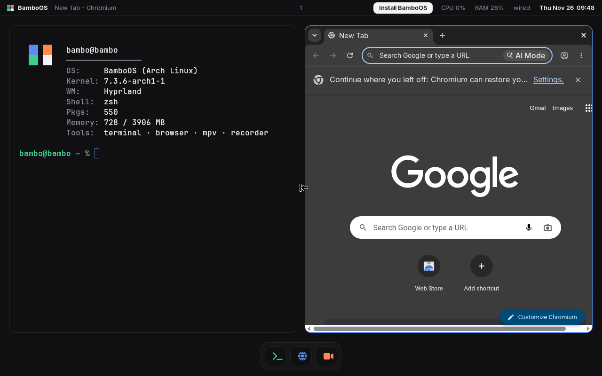

# BamboOS

A minimal Arch Linux spin that looks right out of the box and ships only what a developer needs: a good terminal, a browser, a video player and screen capture. Everything is driven from the keyboard, in the style of Omarchy.

BamboOS is the bicycle of Linux distros: light, simple, nothing extra.

- **No desktop environment.** Hyprland (tiling Wayland compositor) only.
- **Four tool groups.** Terminal (kitty), browser (Chromium), media (mpv), capture (grim, slurp, wf-recorder).
- **Keyboard first.** `Super` is the centre. The mouse is optional.
- **One look.** The "Tessera" design language: charcoal, hairline borders, Inter and JetBrains Mono, blue / orange / green accents.
- **Agent ready.** Docker, Node LTS, Python + uv and tmux are preinstalled. `bambo-agent on` turns the machine into a headless box for AI coding agents.
- **Plain Arch underneath.** No forked packages, no extra repo. `pacman -Syu` updates it.



The screenshot is taken by CI from the live ISO running in QEMU. Status: v0.1, early. See [Status](#status) for what is verified and what is not.

## Try it in 5 minutes

1. Get the ISO. Either download the `bambo-os-iso` artifact from the latest green run under the Actions tab, or build it yourself:

   ```bash
   make iso
   ```

   On Arch this runs `mkarchiso` directly. Elsewhere it uses Docker. The ISO lands in `out/`.

2. Flash it to a USB stick (replace `/dev/sdX`, this erases the stick):

   ```bash
   sudo dd if=out/bambo-os-*.iso of=/dev/sdX bs=4M status=progress oflag=sync
   ```

   Or boot it in a VM: `make try` (full screen, macOS or Linux) or `make test-vm` (window, Linux with KVM).

3. Boot. Turn Secure Boot off in the firmware first. You land in the desktop with no password.

4. Press `Super + /` to see every shortcut. `Super + Enter` opens a terminal.

5. To keep it, click **Install BamboOS** in the top bar or run:

   ```bash
   bambo-install
   ```

   It asks for disk, hostname, username and password, then wipes the disk and installs. It needs an internet connection (`nmtui` for Wi-Fi).

On an Apple Silicon Mac, skip the ISO. `make arm64` builds a ready-to-boot arm64 image and `make try` opens it full screen at native CPU speed. See [docs/quickstart.md](docs/quickstart.md).

More detail: [docs/quickstart.md](docs/quickstart.md).

## Keyboard

The chords follow Omarchy, so there is nothing to relearn. The full list is on `Super + K`.

- `Super + Enter`: terminal
- `Super + Shift + Enter`: browser
- `Super + Space`: app launcher
- `Super + Shift + F`: file manager (yazi)
- `Super + Shift + N`: Neovim, set up as LazyVim (press `Space` inside for its menu)
- `Super + Shift + A`: Codex agent. In a terminal, `cy` starts it with no approval prompts
- `Super + W`: close window
- `Super + F`: fullscreen
- `Super + T`: toggle floating / tiling
- `Super + Arrows`: move focus
- `Super + Shift + Arrows`: swap window position
- `Super + 1..0`: switch workspace
- `Super + Shift + 1..0`: move window to workspace
- `Super + C / V`: copy and paste, in the terminal too
- `Super + Shift + S`: screenshot a region, saved to `~/Pictures` and copied
- `Super + Shift + R`: start / stop screen recording, saved to `~/Videos`, red dot in the bar while recording
- `Super + Escape`: power menu (lock, logout, reboot, shutdown)
- `Super + K`: cheat sheet

## What is in the box

- Base: Arch Linux (rolling), `linux` kernel, NetworkManager, PipeWire
- Desktop: Hyprland, waybar (top bar and dock), rofi, mako, hyprlock
- Tools: kitty, Chromium, mpv, grim, slurp, wf-recorder
- Shell: zsh, starship, tmux, neovim, git, ripgrep, fzf, jq, btop
- Agent runtimes: Docker, Node.js LTS, Python, uv
- Commands: `bambo-install`, `bambo-agent`, `bambo-keys`, `bambo-shot`, `bambo-record`, `bambo-power`, `bambo-fetch`

The full list is [iso/packages.x86_64](iso/packages.x86_64). There is no settings app. Every setting is a text file in [config/](config/), copied to `~/.config` for new users.

## Repo layout

```
iso/                archiso profile (based on upstream releng)
  packages.x86_64   packages installed to disk
  packages.live     extra packages only the live ISO needs
  airootfs/         files overlaid on the live root filesystem
config/             dotfiles, the single source of truth (lands in /etc/skel)
scripts/            bambo-* commands, build-iso.sh, smoke-test.sh, verify-hypr.sh
themes/tessera/     design tokens, logo, wallpaper generator
docs/               quickstart, agent mode, decisions, PRD
Makefile            make iso / lint / try / test-vm / smoke
```

## Agent mode

```bash
bambo-agent on
```

No desktop on the next login, `sshd` and Docker enabled, a long-running tmux session named `agents`. See [docs/agent-mode.md](docs/agent-mode.md).

## Status

Checked by CI on every push, against current Arch (see the Actions tab):

CI builds two images: the release ISO, and a test ISO that is the same plus a small reporting service (`bambo-smoke`). The boot and install checks below run on the test ISO.

- Shell scripts pass `shellcheck`, Lua passes `luac`, Hyprland itself accepts the config (`Hyprland --verify-config`)
- The ISO builds. Last measured: 2.2 GB (target 2.5 GB or less)
- The ISO boots in QEMU (BIOS) to the Hyprland desktop with waybar running
- Inside that VM: the terminal opens, `bambo-shot` saves a screenshot, `bambo-record` saves a recording, Chromium starts
- Real key presses sent into the VM open the terminal, launcher, cheat sheet and power menu, toggle recording and lock the screen
- Chromium runs as a native Wayland client
- `bambo-install` (unattended mode) installs to a blank virtual disk, and that disk then boots to the desktop. Last measured: 547 packages, 5.5 GB on disk, 1 min 33 s on the CI network
- Memory in use about 30 s after the desktop is up: about 600 MB in the live session, about 530 MB installed (target 800 MB or less, measured in a 4 GB VM with software rendering)

Checked by hand on one machine (MacBook Pro M5, QEMU 11.1 with HVF), not by CI:

- `make arm64` builds the arm64 image from Arch Linux ARM. Last measured: 1.9 GB image, 528 packages, 4.4 GB installed (Codex from npm is about 0.4 GB of that)
- The image boots to the Hyprland desktop in about 8 s at 1512x982, with the top bar and the dock. Memory in use at idle: about 350 MB
- Terminal, Chromium (native Wayland) and the cheat sheet open, and the network works

Not verified yet:

- The arm64 image beyond the list above: recording, screenshots, audio and key presses from a real keyboard were not tested, and it has no CI job

- Real hardware of any kind, and UEFI boot (CI covers the BIOS path only)
- Wi-Fi setup, audio, laptop keys, multi-monitor
- Boot time
- The interactive questions of `bambo-install` as a whole. CI uses the unattended mode. The disk menu and yes/no prompts were checked separately in a scripted terminal.

Known gaps against the v0.1 targets:

- Package count is 550 with dependencies (target 250). The explicit list is about 60 packages. Chromium, mpv, Hyprland and Docker bring the rest, so the target is not reachable with all four tool groups in the set.
- No NVIDIA support, no Secure Boot, no disk encryption.
- The installer needs the network (it uses `pacstrap`, about 1.2 GB download).

Design choices and their reasons are in [docs/decisions.md](docs/decisions.md).

## License

GPL-3.0-or-later. The `iso/` profile is derived from the archiso `releng` profile.
